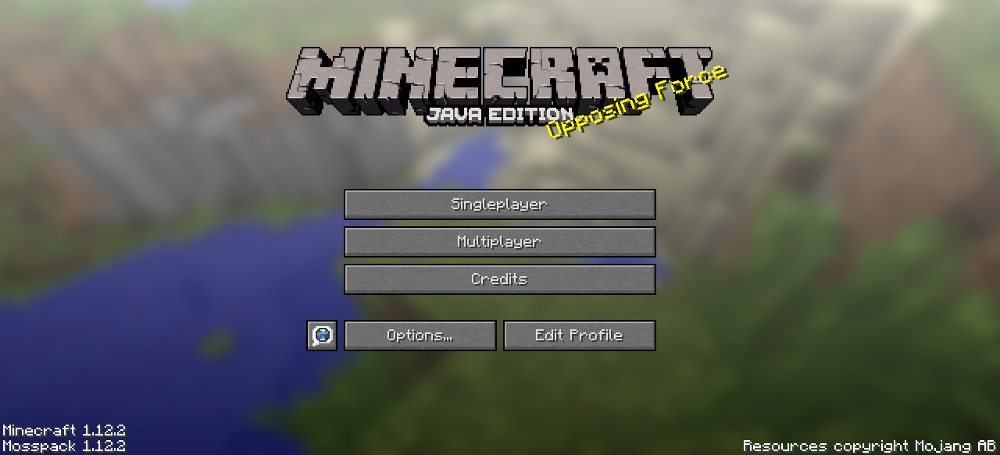
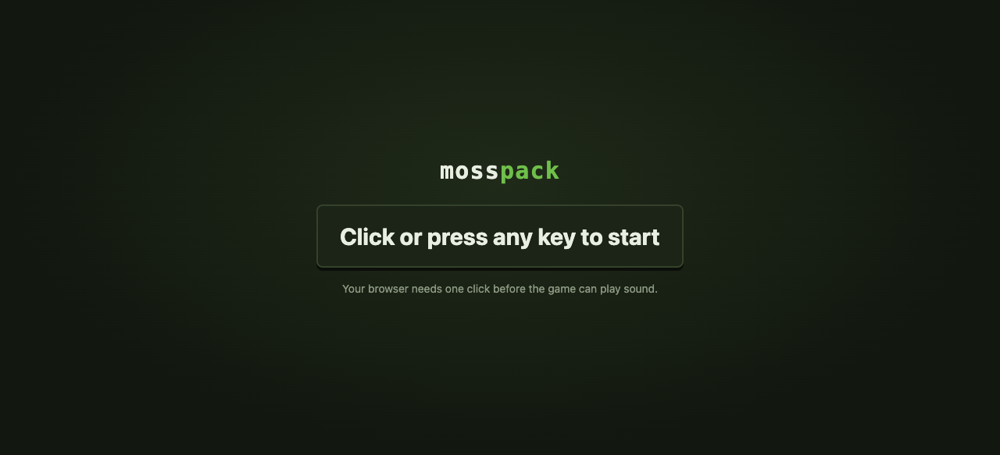
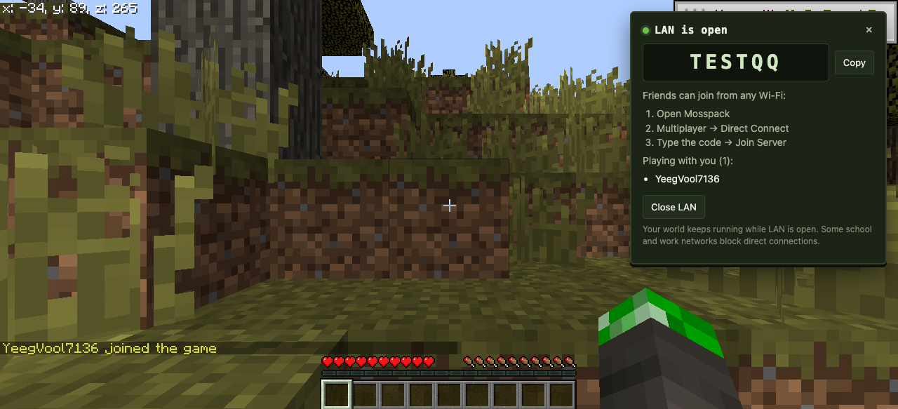
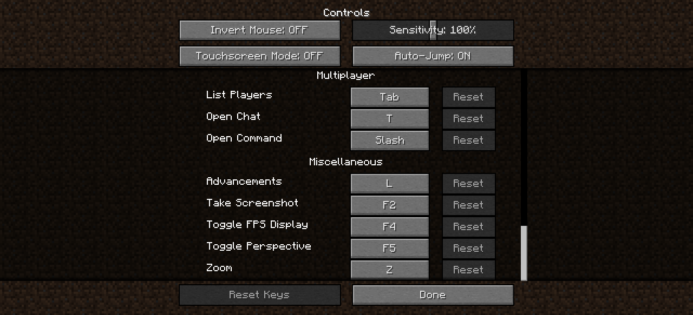
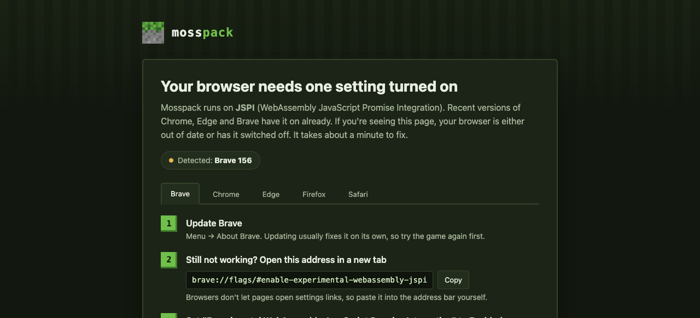
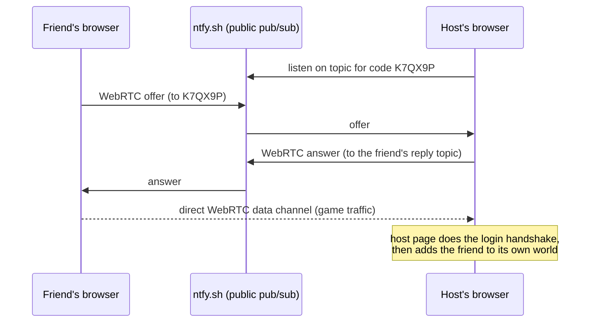

<div align="center">

# mosspack

**Minecraft 1.12.2 in one HTML file. Open it in your browser and play: singleplayer, multiplayer, and LAN with friends on any network.**



[Download the latest release](../../releases/latest) · [Playing with friends](#playing-with-friends-lan) · [Troubleshooting](#troubleshooting)

</div>

---

## What's in it

- **One file, no install.** Everything (game, textures, sounds) is packed into a single `Mosspack.html`. It runs offline.
- **LAN that works anywhere.** Press Esc → **Open to LAN** and you get a six-letter code. Friends type it into
  Direct Connect from their own Wi-Fi, school network or phone hotspot. No server, no port forwarding, no app.
- **Zoom** (hold **Z**) and a **Toggle FPS Display** key (**F4**), both rebindable in Controls.
- **Quality-of-life fixes:** starts straight to the title screen, clear start screen, faster list scrolling,
  join/leave notifications, and a friendly page instead of a blank screen when a browser can't run it.

| | |
|---|---|
|  |  |
|  |  |

## Play

1. Download **`Mosspack.html`** from [Releases](../../releases/latest).
2. Open it in **Chrome, Edge or Brave**: double-click it, or drag it onto a browser window.
3. Click once on the start screen (browsers need one click before a page can play sound).

Your worlds and settings are saved in the browser, per file location. Keep the file in the same place
(for example your Downloads folder) so your saves stay with it.

### Controls added by Mosspack

| Key | Action |
|---|---|
| **Z** (hold) | Zoom in, like OptiFine |
| **F4** | Show or hide the FPS counter |

Both can be changed in Options → Controls → Miscellaneous.

## Playing with friends (LAN)

**Host**
1. Open a singleplayer world.
2. Press **Esc → Open to LAN**.
3. Send your friends the code from the panel (for example `K7QX9P`).

**Friends**
1. Open their own copy of `Mosspack.html`.
2. **Multiplayer → Direct Connect**, type the code, **Join Server**.

Everyone appears in the host's world, and the host gets a notification when someone joins or leaves.
While LAN is open the world keeps running, even with the host's pause menu open.

<details>
<summary>How it works</summary>



- The friend's game thinks it is connecting to a normal server at `ws://K7QX9P`. Mosspack swaps that
  WebSocket for a WebRTC data channel to the host (`src/lan/lan.js`, `LanSocket`).
- The host's page answers the login handshake and plugs the friend into the singleplayer world that is
  already running in the browser, as an extra player.
- ntfy.sh is only used to swap the two connection offers. Game traffic goes directly between players.
- Connections use public STUN servers (Google, Cloudflare) to get through home routers. Very locked-down
  networks (some schools and offices) block direct connections; see Troubleshooting.

</details>

## Browser support

| Browser | Works? |
|---|---|
| Chrome, Edge, Brave, Opera (version 137 or newer) | ✅ Yes |
| Chromebook (ChromeOS up to date) | ✅ Yes |
| Firefox | ⚠️ Only with experimental settings; not recommended |
| Safari (Mac, iPhone, iPad) | ❌ Not yet. Safari doesn't support WebAssembly JSPI |

Mosspack needs two newer WebAssembly features, **GC** and **JSPI**. If either is missing, the page explains what
to update instead of loading.

## Troubleshooting

**The page is white or blank.**
Mosspack now shows a message if it can't start. If you still see nothing:
- Update the browser (Chromebook: Settings → About ChromeOS → Check for updates).
- Download the file first and open it from Downloads. Previews inside Google Drive or email don't run it.
- Close other tabs. The game needs about 1 GB of memory.

**My friend can't connect.**
- Both of you need an internet connection, even on the same Wi-Fi, to swap the connection offer.
- Check the code. It's six characters and has no `0`, `O`, `1`, `I` or `L`.
- School, work and some public networks block direct connections. Try a home network or a phone hotspot.
- Testing with two tabs on one computer? The browser pauses the tab you're not looking at, so that player
  freezes. Use two windows side by side, or two devices.

**I want to start over.**
Open the file with `#reset` added to the end of the address (for example `.../Mosspack.html#reset`) and click
**Delete everything**. That clears this browser's worlds, resource packs, servers, settings and profile
for that file.

**It runs slowly.** Lower Render Distance, turn Clouds off and set Particles to Decreased in Video Settings.

## What's in this repository

Only original Mosspack code and release builds. Game code and assets are not stored here.

```
src/core.js              shared helpers and the hooks Mosspack adds to the game runtime
src/lan/lan.js           LAN: code generation, WebRTC matchmaking, host bridge, LanSocket
src/ui/start-screen.js   the "Click or press any key to start" screen
src/ui/preflight.html    browser checks, loading screen, no-blank-page safety net, #reset
src/ui/browser-help.html page shown when the browser lacks JSPI
tools/                   packaging tools (string pool, asset pack and single-file packers; logo art)
docs/screenshots/        images used in this README
```

## Credits and legal

Mosspack is a personal, non-commercial project and is **not affiliated with Mojang or Microsoft**.

- **Minecraft** is © Mojang Studios / Microsoft. The game and its assets belong to them.
- Built on **Eaglercraft 1.12** by PeytonPlayz585, which is based on **EaglercraftX** by lax1dude and ayunami2000.
- Compiled with **TeaVM**; packaging uses **binaryen**; LAN matchmaking uses **ntfy.sh**.

The release file contains Minecraft's code and assets, so this repository should stay **private**. Don't share
or host the release publicly.
